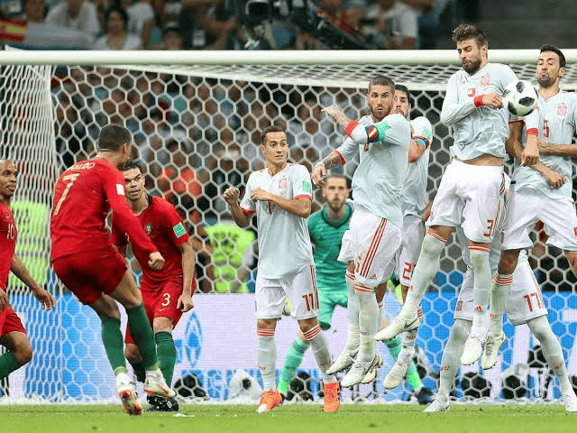

Nama    : Johannes Hutagalung
Nim     : 41426034
Prodi   : DIV-Teknologi Rekayasa Perangkat Lunak

Laporan Praktikum PSW I - Minggu 6 Sesi 3

1. GAMBAR FLEKSIBEL
Catatan Pengamatan: Gambar Fleksibel
Tindakan yang Dilakukan
Menambahkan atribut CSS responsif pada file `style.css`
   img { 
       max-width: 100%; 
       height: auto; 
   }
Hasil Nyata:
Perilaku Gambar: Saat ukuran viewport/layar browser diperkecil, gambar dapat menyusut secara proporsional sesuai lebar kontainer (.card) tanpa terdistorsi/gepeng.
Rasio Gambar: Atribut height: auto menjaga aspect ratio gambar tetap aman dan fleksibel di berbagai ukuran layar.
Status HTTP: Pada tab Network di DevTools, seluruh gambar memuat dengan status 200 OK (tidak ada error 404).

2. KANDIDAT RESOLUSI
Catatan Pengamatan: Kandidat Resolusi (Resolution Switching)
Tindakan yang Dilakukan
Menyiapkan aset gambar varian ukuran (`cr7-320.png` dan `cr7-640.png`) ke dalam folder `gambar/` serta menerapkan atribut `srcset` dan `sizes` pada elemen `` Cristiano Ronaldo di file `index.html`:
    
Hasil Nyata:
* Pemilihan Sumber Gambar: Browser secara cerdas menentukan file gambar yang dimuat (`currentSrc`) berdasarkan lebar viewport atau ukuran layar yang sedang aktif.
* Pengujian DevTools Console: Perintah `document.querySelector('img').currentSrc` berhasil dijalankan dan menampilkan jalur file gambar aktif dengan bersih tanpa error.
* Bukti Pengujian: Tangkapan layar hasil pengujian disimpan pada direktori `bukti/4-kandidat-resolusi.png`.

3. FLUID FONT DAN CONTAINER QUERY
Catatan Pengamatan: Fluid Typography dan Container Query
Tindakan yang Dilakukan
Menambahkan kode `clamp()` di elemen `h1` agar ukuran hurufnya bisa membesar dan mengecil secara halus mengikuti layar. Selain itu, bagian `.catalog` diatur sebagai kontainer dengan `container-type: inline-size` lalu ditambahkan `@container (min-width: 30rem)` supaya padding kartu ikut berubah menyesuaikan ukuran wadahnya
Hasil Nyata:
* Ukuran Font (Poin 1): Pas diliat di tab Computed DevTools, ukuran huruf `h1` berubah otomatis dari sekitar 28px waktu layar sempit jadi 48px waktu layar dilebarkan.
* Perilaku Wadah/Container (Poin 2): Kotak kartu (`.card`) otomatis nambah padding-nya pas lebar wadah utamanya (`.catalog`) ngelewatin batas 30rem, tanpa harus ngecilin ukuran layar browser secara keseluruhan.
* Beda Query (Poin 3): Media Query itu ngecek ukuran layar keseluruhan (viewport), sedangkan Container Query cuma ngecek ukuran kotak pembungkus tempat komponen itu tinggal.

4. REDUCED MOTION DAN AUDIT
Catatan Pengamatan: Aksesibilitas dan Reduced Motion
Tindakan yang Dilakukan
Menambahkan media query `@media (prefers-reduced-motion: reduce)` pada file `style.css` untuk mematikan transisi kartu (`transition: none;`) bagi pengguna yang mengaktifkan pengaturan pengurangan gerakan di perangkat mereka.

Hasil Nyata:
* Emulasi Reduced Motion (Poin 1): Saat diuji lewat tools browser, animasi atau transisi pada elemen `.card` berhasil dinonaktifkan secara otomatis sesuai preferensi aksesibilitas.
* Uji Keyboard & Zoom (Poin 2): Navigasi menggunakan tombol keyboard (Tab) dan perbesaran layar (*zoom*) berjalan normal tanpa ada fungsi tombol atau tautan yang rusak.
* Informasi Tanpa Hover (Poin 3): Seluruh informasi penting pada kartu tetap tampil secara permanen dan terbaca dengan baik tanpa harus mengandalkan efek *hover* kursor.
* Validasi & Bukti (Poin 4): Pengujian audit aksesibilitas berhasil diselesaikan dengan baik.

5. LATIHAN MANDIRI DAN MATRIKS UJI
Catatan Pengamatan: Pengujian Matriks Uji Kasus
* Kasus Normal: Memuat halaman dengan ukuran layar normal, menjalankan gambar `srcset`, dan mengecek transisi kartu. Hasil aktualnya aset gambar termuat dengan resolusi tinggi, font fleksibel, serta padding kartu menyesuaikan ruang kontainer dengan lancar (Status: Sesuai, bukti tersimpan di folder `bukti/`).
* Kasus Batas: Mengubah ukuran viewport ke ukuran sangat sempit atau memperbesar zoom halaman hingga batas maksimal. Hasil aktualnya layout tetap rapi, teks judul mengecil secara halus lewat fungsi `clamp()`, dan navigasi tombol tetap bisa diakses tanpa rusak (Status: Sesuai).
* Kasus Gagal: Menguji penulisan path gambar yang disengaja salah atau menguji tanpa mengaktifkan container query. Hasil aktualnya pada awalnya gambar sempat gagal termuat, lalu langsung diperbaiki dengan memastikan nama file fisik dan atribut kodenya sudah sinkron (Status: Telah diretest dan diperbaiki).

6. TROUBLESHOOTING DAN AI USE STATEMENT
Catatan Pengamatan: Pemecahan Masalah dan Pernyataan Penggunaan AI
* Troubleshooting: Selama pengerjaan, jika terjadi kendala seperti perubahan yang tidak tampil atau error 404, pemeriksaan dilakukan secara teliti pada penyimpanan file, penulisan path folder, serta kapitalisasi nama file sesuai panduan modul.
* AI Use Statement: Dalam penyusunan dan pemahaman konsep praktikum ini, penulis menggunakan bantuan AI secara proporsional untuk memahami konsep sintaks CSS (seperti clamp dan container query), dengan tetap menguji seluruh saran kode secara mandiri pada browser dan memastikan kemampuan menjelaskan kode secara langsung.